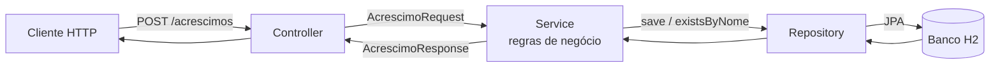

# Backlog Pet Shop

API do pet shop. Esta entrega implementa a **US05 - Cadastro de acréscimo** (issue #5),
organizada em camadas **Controller → Service → Repository**.

## Arquitetura



| Camada | Responsabilidade | Não faz |
|---|---|---|
| **Controller** | Receber a requisição HTTP, validar formato (`@Valid`), delegar e devolver status | Regra de negócio, acesso a banco |
| **Service** | Regras de negócio (valor > 0, nome único), orquestração | Conhecer HTTP |
| **Repository** | Persistência (Spring Data JPA) | Regras de negócio |

### Estrutura de pastas

```
src/main/java/com/petshop/acrescimo
├── controller/   AcrescimoController
├── service/      AcrescimoService
├── repository/   AcrescimoRepository
├── model/        Acrescimo (entidade)
├── dto/          AcrescimoRequest, AcrescimoResponse
└── exception/    RegraNegocioException, GlobalExceptionHandler
```

## Regras de negócio (US05)
- **RN01:** o valor do acréscimo deve ser maior que zero.
- **RN02:** não pode haver dois acréscimos com o mesmo nome (sem diferenciar maiúsculas/minúsculas).

## Como executar
```bash
mvn spring-boot:run     # sobe em http://localhost:8080
mvn test                # roda os testes
```

## Exemplos
```bash
curl -X POST localhost:8080/acrescimos -H "Content-Type: application/json" \
  -d '{"nome":"Perfume","descricao":"Banho perfumado","valor":15.00}'

curl localhost:8080/acrescimos
```
| Situação | Status |
|---|---|
| Cadastro válido | 201 |
| Campo obrigatório ausente | 400 |
| Valor ≤ 0 ou nome duplicado | 422 |
